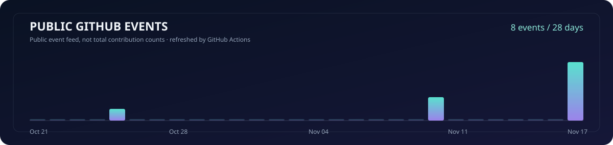

  
  
<strong>Independent developer · creative technologist · producer</strong>

  

    <a href="#featured-public-work">Public work</a> ·
    <a href="#open-source">Open source</a> ·
    <a href="#public-activity">Activity</a> ·
    <a href="#learn-in-public">Lessons</a>
  

## About

I'm **Sir Davi**, a multidisciplinary creator working across software, research, and independent media through **Lucky Number Media**.

My background includes music production, writing and recording, video editing, and visual design. That creative work informs how I approach engineering: start with the whole system, investigate the mechanics, build a working example, and validate what it really does.

I'm particularly interested in the boundary between low-level systems, AI, graphics, real-time interfaces, and the tools people actually use.

## Where I focus

| Area | What I'm exploring |
| :-- | :-- |
| **Software & systems** | CLI tooling, integrations, desktop/web applications, reliable test and release workflows |
| **Graphics & interactivity** | Shaders, simulation, game technology, real-time rendering, interface animation |
| **AI & research** | Model tooling, repeatable experiments, applied systems research |
| **Media & production** | Rap/hip-hop, recording, video production, editing, visual storytelling, creative tooling |

## Featured public work

| Work | What it demonstrates | Current state |
| :-- | :-- | :-- |
| [**GitHub profile source**](https://github.com/ihatesirdavi/ihatesirdavi) | Editable SVG design, Python validators, GitHub Actions, and documented lessons | Public and tested |
| [**AcerolaFX contribution**](https://github.com/GarrettGunnell/AcerolaFX/pull/64) | Reproducing broken links, checking evidence, writing a minimal upstream patch | PR #64 submitted for review |
| [**GDScript Toolkit contribution**](https://github.com/Scony/godot-gdscript-toolkit/pull/435) | Python formatter bug fix, regression tests, and semantic checks | PR #435 open; CI approval pending |
| [**First Contributions fork**](https://github.com/ihatesirdavi/first-contributions) | Understanding fork, branch, commit and PR workflows | Public learning resource |
| [**VS Code extensions workspace**](https://github.com/ihatesirdavi/vscode-extensions) | Shared extension workspace and provisional visual branding | Public source; release not verified |

My larger engineering and creative projects are developed independently. This page links only public material and does not claim that private work has been shipped.

## Tools and creative software

**Software:** Git · GitHub Actions · Python · Go · Rust · TypeScript · Tauri · VS Code

**Graphics and interactive:** Blender · Godot · Adobe creative tools · shader research

**Audio and video:** FL Studio · recording, editing, and digital production workflows

These are tools I use or actively explore, not a claim of equal expertise or published proficiency in each.

## Public activity

This chart counts recent events from GitHub's public events API only. It is not the platform's full contribution calendar and does not read private repository activity. See the <a href="scripts/render_public_activity.py">generator source</a>.

## Open source

I prefer **small, reproducible upstream contributions**: verify the issue, check the maintainer's expectations, write an understandable change, test it, and make the PR reviewable.

- [AcerolaFX issue #63](https://github.com/GarrettGunnell/AcerolaFX/issues/63) → [PR #64](https://github.com/GarrettGunnell/AcerolaFX/pull/64): remove broken README gallery links while preserving existing screenshots.
- [GDScript Toolkit issue #394](https://github.com/Scony/godot-gdscript-toolkit/issues/394) -> [PR #435](https://github.com/Scony/godot-gdscript-toolkit/pull/435): preserve warning-annotation newlines and test the result.
- [Explore repositories](https://github.com/ihatesirdavi?tab=repositories) and [pull requests](https://github.com/pulls?q=is%3Apr+author%3Aihatesirdavi) for the current public record.

A submitted pull request is not the same as a merged contribution.

## Learn in public

| Lesson | Learn | Practice |
| :-- | :-- | :-- |
| [**01 · Profile as code**](docs/lessons/01-profile-as-code.md) | Markdown, SVG, Git, local validation | Break an asset link and fix it |
| [**02 · Upstream contribution**](docs/lessons/02-upstream-contribution.md) | Redirects, minimal diffs, branch hygiene | Explain the issue and inspect the PR |
| [**03 · Public activity graphic**](docs/lessons/03-public-activity.md) | Python, dates, APIs, XML, regression testing | Change the time window and test the results |
| [**04 - GDScript formatter bug**](docs/lessons/04-gdscript-formatter.md) | Python, syntax trees, regression tests, and AST safety | Reproduce 3 failures and verify the patch |

## Working method

**Understand → practice → validate → explain.**

I care about clean boundaries, honest release status, reusable tools, and understanding *why* a solution works.

---

**Build and provenance:** Python 3.11, Git/GitHub CLI, GitHub Actions, SVG/XML checks; seven profile tests and CI passed. I personally review and double-check the work and its factual claims, with agents assisting implementation, review, and source verification. External maintainer acceptance remains separate. [Specs, test stack, and evidence](docs/contribution-evidence.md).
