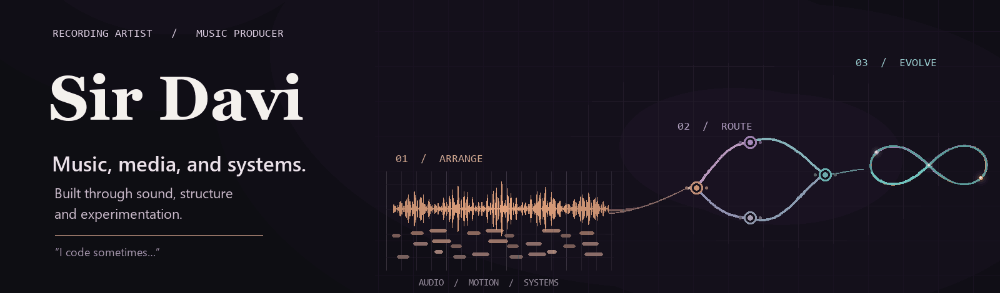

  
  
<strong>Recording artist and music producer. Creative technologist and systems designer.</strong>

  
“I code sometimes…”

  

    <a href="#public-previews">Previews</a> ·
    <a href="#featured-public-work">Public work</a> ·
    <a href="#open-source">Open source</a> ·
    <a href="#public-activity">Activity</a> ·
    <a href="#learn-in-public">Lessons</a>
  

## About

I'm **Sir Davi**, a recording artist, music producer, writer, and multimedia creator. Music production is the foundation of how I build things, not a past life I abandoned to become a programmer. In recording and production, the job is to turn an idea into a complete, coherent experience: writing, arrangement, vocal performance, recording, editing, mixing, visuals, and release preparation.

That work led naturally into **systems architecture, interactive graphics, tools, simulations, and agent-assisted research**. A good production session and a well-designed technical system have more in common than their interfaces suggest. Both depend on coordinated components, timing, signal flow, iterative listening or testing, and a result that works as a whole.

I work across FL Studio, Adobe creative applications, video and graphic production, software interfaces, integration, and experiments. Code is a useful instrument, but the primary question remains: **What should this do, and what makes the experience work?**

## Music as systems thinking

| Production discipline | How it carries into current work |
| :-- | :-- |
| **Songwriting and arrangement** | Architecture: organizing components into coherent structures, sequences, and experiences |
| **Signal routing, buses, and effects** | Interfaces and integrations: understanding inputs, transformations, dependencies, and outputs |
| **Timing, automation, and performance** | Animation, interactive controls, synchronized events, and real-time feedback |
| **Mixing and critical listening** | Debugging and validation: isolate a problem, compare revisions, improve the entire result |
| **Final mix, video edit, and delivery** | Packaging and release workflows: reproducible outputs, quality checks, and explicit acceptance |

The public demonstrations below show small pieces of that transition. Their codenames protect unreleased work and their tests describe what is actually verified.
## Where I focus

| Area | What I'm exploring |
| :-- | :-- |
| **Software & systems** | CLI tooling, integrations, desktop/web applications, reliable test and release workflows |
| **Graphics & interactivity** | Shaders, simulation, game technology, real-time rendering, interface animation |
| **Agents & research** | Model tooling, agent workflows, repeatable experiments and applied systems research |
| **Media & production** | Rap/hip-hop, recording, video production, editing, visual storytelling, creative tooling |

## Public previews

A narrow window into original, standalone functional and visual studies. Unreleased products are represented by public codenames only, without exposing their private identity, source, or release mapping.

  
  

**[SIGNAL-001](https://ihatesirdavi.github.io/preview-lab/):** Three visual states and bounded interactive animation.

**[DYNAMICS-002](https://ihatesirdavi.github.io/preview-lab/dynamics.html):** A deterministic three-body simulation, testable numerical integration, and 60/30 FPS rendering profiles.

Both are standalone public prototypes, with authentic Chrome captures and source/browser checks. Owner review pending; neither is a packaged release or a disclosure of private project identities. [Evidence and source](https://github.com/ihatesirdavi/preview-lab).
## Featured public work

| Work | What it demonstrates | Current state |
| :-- | :-- | :-- |
| [**SIGNAL-001 / Preview Lab**](https://ihatesirdavi.github.io/preview-lab/) | Original bounded interactive field, three visual modes, tested source and preview evidence | Public prototype; owner acceptance pending |
| [**DYNAMICS-002 / Preview Lab**](https://ihatesirdavi.github.io/preview-lab/dynamics.html) | Three-body gravitational simulation, measured energy drift, native regression tests, bounded visuals | Public prototype; owner review pending |
| [**GitHub profile source**](https://github.com/ihatesirdavi/ihatesirdavi) | Reproducible raster/motion design from real previews, Python validators, GitHub Actions, and documented lessons | Public source; new visual pending owner acceptance |
| [**AcerolaFX contribution**](https://github.com/GarrettGunnell/AcerolaFX/pull/64) | Reproducing broken links, checking evidence, writing a minimal upstream patch | PR #64 submitted for review |
| [**GDScript Toolkit contribution**](https://github.com/Scony/godot-gdscript-toolkit/pull/435) | Python formatter bug fix, regression tests, and semantic checks | PR #435 open; CI approval pending |
| [**Sunday Parcel**](https://github.com/ihatesirdavi/sunday-parcel) | Read-only VS Code extension source workbench for local development receipts | Source only; no VSIX or release published |

Projects in transition are represented by owner-cleared public previews under codenames only. Private names, source and packaging status remain withheld until the owner approves release.

## Tools and creative software

**Software:** Git · GitHub Actions · Python · Go · Rust · TypeScript · Tauri · VS Code

**Graphics and interactive:** Blender · Godot · Adobe creative tools · shader research

**Audio and video:** FL Studio · recording, editing, and digital production workflows

These are tools I use or actively explore, not a claim of equal expertise or published proficiency in each.

## Public activity

This chart counts recent events from GitHub's public events API only. It is not the platform's full contribution calendar and does not read private repository activity. See the <a href="scripts/render_public_activity.py">generator source</a>.

## Open source

I prefer **small, reproducible upstream contributions**: verify the issue, check the maintainer's expectations, write an understandable change, test it, and make the PR reviewable.

- [AcerolaFX issue #63](https://github.com/GarrettGunnell/AcerolaFX/issues/63) → [PR #64](https://github.com/GarrettGunnell/AcerolaFX/pull/64): remove broken README gallery links while preserving existing screenshots.
- [GDScript Toolkit issue #394](https://github.com/Scony/godot-gdscript-toolkit/issues/394) -> [PR #435](https://github.com/Scony/godot-gdscript-toolkit/pull/435): preserve warning-annotation newlines and test the result.
- [Explore repositories](https://github.com/ihatesirdavi?tab=repositories) and [pull requests](https://github.com/pulls?q=is%3Apr+author%3Aihatesirdavi) for the current public record.

A submitted pull request is not the same as a merged contribution.

## Learn in public

| Lesson | Learn | Practice |
| :-- | :-- | :-- |
| [**01 · Profile as code**](docs/lessons/01-profile-as-code.md) | Markdown, SVG, Git, local validation | Break an asset link and fix it |
| [**02 · Upstream contribution**](docs/lessons/02-upstream-contribution.md) | Redirects, minimal diffs, branch hygiene | Explain the issue and inspect the PR |
| [**03 · Public activity graphic**](docs/lessons/03-public-activity.md) | Python, dates, APIs, XML, regression testing | Change the time window and test the results |
| [**04 - GDScript formatter bug**](docs/lessons/04-gdscript-formatter.md) | Python, syntax trees, regression tests, and AST safety | Reproduce 3 failures and verify the patch |

## Working method

**Understand → design → practice → validate → explain.**

I care about clean boundaries, honest release status, reusable tools, and understanding *why* a solution works.

---

**Build and provenance:** Python 3.11, Git/GitHub CLI, GitHub Actions, SVG/XML checks; profile test results and CI are recorded in GitHub Actions. I personally review and double-check the work and its factual claims, with agents assisting implementation, review, and source verification. External maintainer acceptance remains separate. [Specs, test stack, and evidence](docs/contribution-evidence.md).
